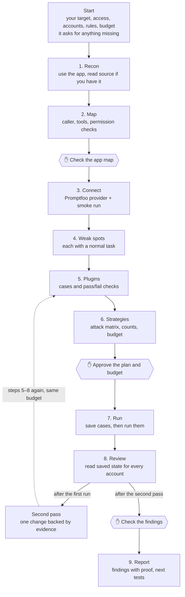

# promptfoo-assessment

An agent skill for red-teaming an AI application with [Promptfoo](https://www.promptfoo.dev). The agent runs the assessment from first look to final report. You make the calls at three checkpoints.

The agent reads `SKILL.md` and the files in `references/`. This README is for people.

## The flow

At each ✋ the agent stops, shows you a short summary and waits for your answer.

1. **Check the app map.** Is anything missing or wrong about how the app works?
2. **Approve the plan and budget.** This is what runs, how many requests it costs, what it changes and which outside services see your data. Nothing runs before you say yes.
3. **Check the findings.** Each finding comes with its proof. Check any two against the app yourself.

## What it checks along the way

- **Normal tasks.** Every attack is paired with a normal request that should still work. If the normal request fails, the attack result doesn't count.
- **Saved state, not replies.** Pass and fail come from what the app saved, for every test account, not from what the model said it did.
- **Small first runs.** One test per plugin, `basic` plus one capped multi-turn strategy, one run per case, about 12 test cases at most, then about 6 new ones on the second pass. It asks before going bigger.
- **Your budget is a hard cap.** By default it counts messages to the app's AI assistant, Promptfoo's included. A clean result is a real result: when the work is done, it stops instead of spending what's left.

## What you get

An engagement folder outside the skill with the scope, app map, attack matrix, Promptfoo provider and configs, saved cases and results for both passes, and a report. See [artifacts and handoff](references/artifacts-and-handoff.md) for the layout.

## Before you start

- Permission to test the app. Only point it at apps you're allowed to test.
- Node 22.22 or later. The agent can install the pinned Promptfoo version (0.125.0) into the engagement folder for you.
- Your own email set in Promptfoo if you use its hosted generation or grading.

Then tell your agent about the target. The method is in the skill, so you only describe the app: the URL, black box or source (and where), the test accounts and how to switch them, the rules it should enforce, what the run may change, the budget and stop time, and which outside services may see your data. It asks for anything you leave out. For example: *"Use promptfoo-assessment to assess the app at <url>. Black box, these two test accounts, these three rules, resets allowed, Promptfoo's hosted grading, budget of 100 messages, stop at 5pm."*

## Files

| File | What's in it |
| --- | --- |
| [SKILL.md](SKILL.md) | The loop, the checkpoints and the rules for each stage |
| [references/intake-and-discovery.md](references/intake-and-discovery.md) | Questions to ask first, and how to map the app |
| [references/adapter-acceptance.md](references/adapter-acceptance.md) | What the Promptfoo provider has to prove before results count |
| [references/attack-matrix.md](references/attack-matrix.md) | The plan file, run sizes and when to ask for more |
| [references/promptfoo-workflow.md](references/promptfoo-workflow.md) | Promptfoo setup, commands and lessons from test runs |
| [references/iteration-and-evidence.md](references/iteration-and-evidence.md) | Verdicts, the second pass and how to compare runs |
| [references/artifacts-and-handoff.md](references/artifacts-and-handoff.md) | Engagement folder layout and what to strip before sharing |
| [agents/openai.yaml](agents/openai.yaml) | Display name and default prompt for Codex |

Install steps for each agent are in the [repo README](https://github.com/brysonjl/bloff-skills#install).
